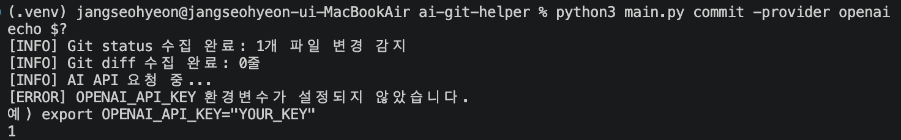
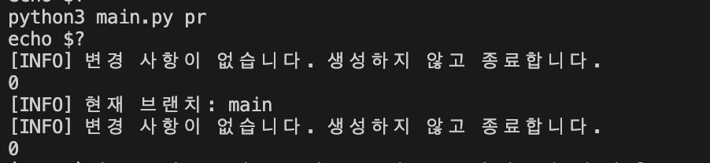
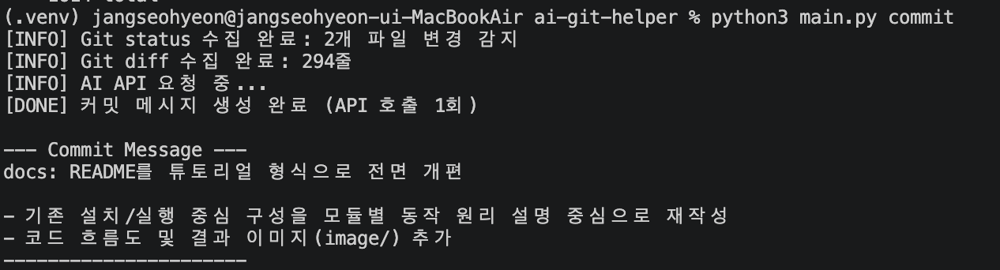
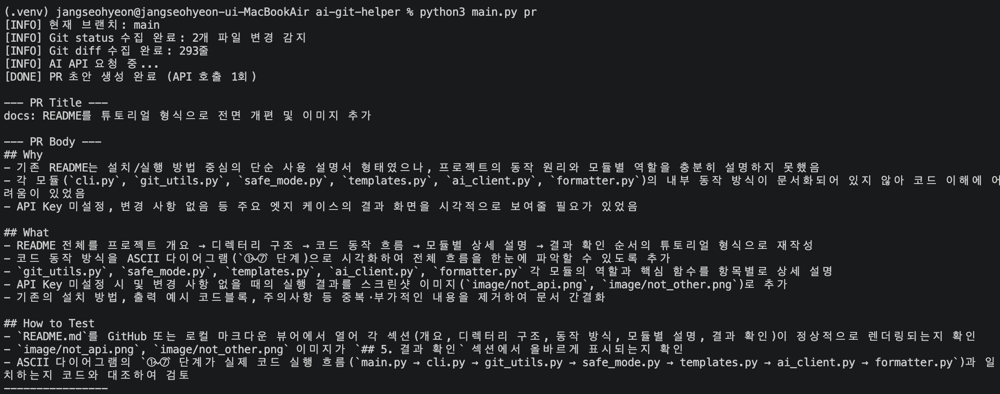
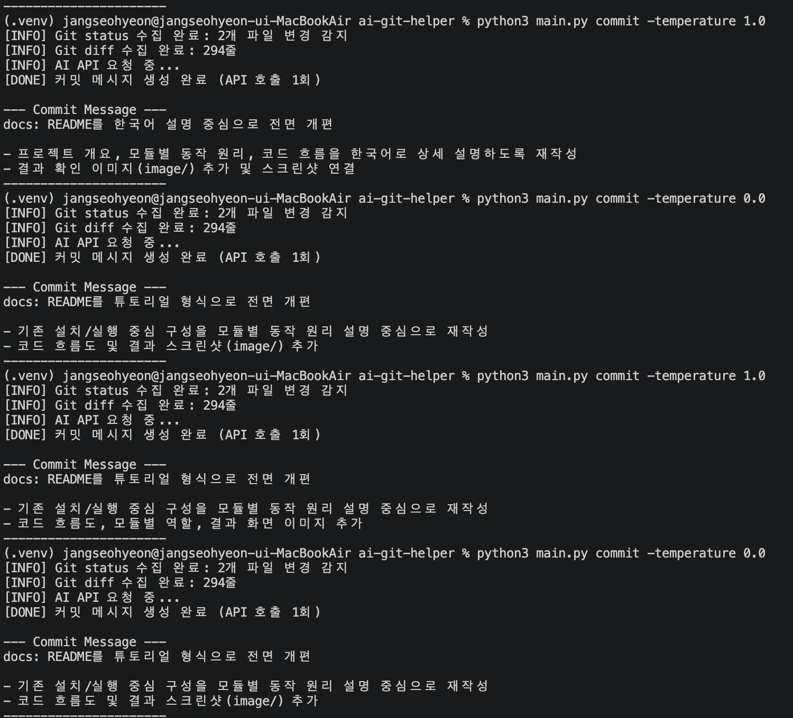
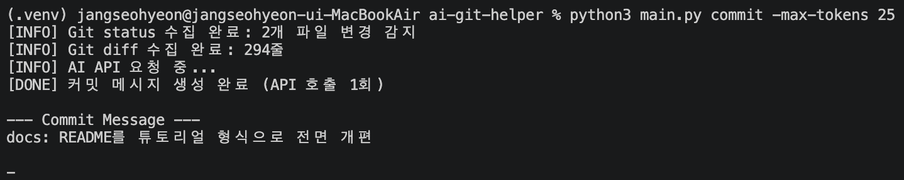

# 내가 고친 코드 설명을 AI가 대신 써주는 도우미 만들기

## 1. 프로젝트 개요
Git 변경 사항을 입력값으로 받아 AI API로 **커밋 메시지와 PR 설명을 자동 생성하는 Python CLI 도구**.

- 단순 호출에 그치지 않고, API 파라미터와 컨텍스트(Commit/PR 양식, 변경 이유, 요구사항)를 설계해 원하는 품질의 결과가 나오도록 프롬프트를 최적화
- Git 명령 실행 결과를 프로그램 입력으로 연결하고, 생성 결과를 실제 커밋/PR 작성 흐름에 적용
- 연동 · 검증 · 자동화를 하나의 흐름으로 구현


## 2. 디렉터리 구조
```
ai-git-helper/
├── gitgen/
│   ├── __init__.py     패키지 정의, 버전 정보
│   ├── cli.py          명령 파싱(commit / pr), 옵션 정의, 실행 흐름 연결, 종료 코드
│   ├── git_utils.py    git status / diff / 브랜치 수집, GitError
│   ├── ai_client.py    AI API 호출(anthropic / openai 호환), API Key 확인, 오류 처리
│   ├── templates.py    커밋 / PR 프롬프트 템플릿 구성
│   ├── formatter.py    응답 파싱, 길이·섹션 규칙 검증 및 보정, 출력 구획
│   └── safe_mode.py    민감정보 마스킹, diff 전송량 제한
├── main.py             CLI 진입점
└── README.md
```


## 3. 코드 동작 방식
```
[사용자 입력]  python3 main.py commit -temperature 0.2
        │
        ▼
① main.py ──▶ cli.py        옵션 해석, commit / pr 중 어느 명령인지 판단
        │
        ▼
② git_utils.py              Git 저장소인지 확인 → git status, git diff 수집
        │   └─ 변경 없음? → "변경 사항이 없습니다" 출력하고 종료
        ▼
③ safe_mode.py (옵션)       민감정보 가리기 + 너무 길면 자르기
        │
        ▼
④ templates.py              "AI에게 보낼 글" 조립 (규칙 + status + diff)
        │
        ▼
⑤ ai_client.py              AI 서버에 요청 → 응답 받기
        │   └─ 실패? → 원인 포함 [ERROR] 출력하고 종료
        ▼
⑥ formatter.py              응답이 규칙을 지켰는지 검사하고 고치기
        │
        ▼
⑦ 터미널 출력                구분선으로 나눠서 보여주기
```


## 4. 모듈별 설명

### cli.py — 명령과 옵션 정리
프로그램이 받을 수 있는 명령과 옵션을 정의함.

| 인자 | 의미 | 기본값 |
| --- | --- | --- |
| `commit` / `pr` | 무엇을 만들지 (필수) | - |
| `-model` | 사용할 AI 모델 | `claude-sonnet-4` |
| `-temperature` | 생성 자유도 | `0.3` |
| `-max-tokens` | 답변 최대 길이 | `1024` |
| `-safe-mode` | 민감정보 보호 켜기 | 꺼짐 |
| `-provider` | AI 서버 규격 (`anthropic` / `openai`) | `anthropic` |

> 코드를 수정하지 않고 값만 바꿔 실험할 수 있고, 명령어 자체에 실행 조건이 남아 재현이 가능함

### git_utils.py — Git 명령 대신 실행
`subprocess.run(["git", …])`으로 Git 명령을 실행하고, 결과 글자(stdout)를 받아옴.

1. **`ensure_git_repo()`**
   `git rev-parse --is-inside-work-tree`로 현재 위치가 Git 저장소인지 확인. 아니면 "Git이 초기화된 프로젝트 루트에서 실행하세요"라고 안내
2. **`get_status()`**
   `git status --porcelain` 실행. 어떤 파일이 바뀌었는지 한 줄씩 짧게 보여줌.
   `--porcelain`은 사람이 아니라 프로그램이 읽기 좋은 고정 형식으로 출력하라는 옵션 (ex. `M todo.md` → 수정됨)
3. **`get_diff()`**
   정확히 무엇이 바뀌었는지 줄 단위로 보여줌 (지운 줄은 `-`, 추가한 줄은 `+`).
   `git diff`(아직 add 안 한 변경)와 `git diff --cached`(add 한 변경)를 둘 다 가져와 합침
4. **`collect_changes()`**
   위 결과를 `ChangeSummary`라는 상자에 담음 (status 글, diff 글, 변경 파일 수, diff 줄 수).
   status 결과가 비어 있으면 `has_changes`가 `False`가 되고, "변경 사항이 없습니다" 출력 후 AI를 호출하지 않고 종료

### safe_mode.py — 안전 처리
`-safe-mode` 옵션이 켜졌을 때만 동작함.
git diff에는 실수로 API 키, 비밀번호, 이메일이 들어갈 수 있고, 그 내용이 외부 AI 서버로 전송되기 때문에 필요함.

1. **마스킹**
   정규식으로 민감해 보이는 글자를 찾아 `[MASKED:종류]`로 바꿈 (ex. `sk-ant-abc123…` 토큰 → `[MASKED:Anthropic key]`)
   대상: API 키, Bearer 토큰, 이메일, password 등
2. **전송량 제한**
   diff를 `diff --git` 기준으로 파일별 조각으로 나누고, 최대 10개 파일 · 최대 200줄까지만 남김.
   잘린 경우 끝에 "일부만 전송됨" 안내를 붙여 AI가 상황을 알게 함

> 순서: 마스킹 → 자르기

### templates.py — 프롬프트 조립
AI에게 보낼 글은 두 부분으로 나뉨.

1. **system 프롬프트**: AI의 역할과 규칙
   ex. "당신은 숙련된 엔지니어입니다. 첫 줄은 `type: 설명` 형식으로, 50자 이내를 권장하며 72자를 넘기지 말고, 한국어로, 코드블록 없이 쓰세요"
2. **user 프롬프트**: 이번에 처리할 자료, 즉 실제 변경 내용
   ex. `## git status ...` / `## git diff ...`

PR용은 다음이 추가됨
- 현재 브랜치 이름 전달
- 응답 형식을 `PR_TITLE: ...` / `PR_BODY:` / `## Why` / `## What` / `## How to Test`로 고정

### ai_client.py — AI 호출
REST API: 인터넷 주소(URL)로 요청을 보내면 응답이 돌아오는 방식

- **anthropic 방식**: Anthropic 공식 도구(SDK) 사용. 키는 `ANTHROPIC_API_KEY`에서 읽음
- **openai 방식**: SDK 없이 `urllib`로 `/v1/chat/completions` 주소에 JSON을 직접 POST. 키는 `OPENAI_API_KEY`에서 읽음

지키는 규칙
1. **키는 환경변수에서만 읽음** — 코드에 키가 남아 유출되지 않게
2. **오류를 종류별로 번역** — 401, 403, 429 등의 오류를 원인이 담긴 메시지로 바꿔, 사용자가 무엇이 잘못됐는지 바로 알 수 있게 함
3. **호출은 1회** — 비용 제약을 지키기 위해

### formatter.py — 검증과 다듬기
AI 응답을 받은 뒤 코드가 한 번 더 검증하고 후처리함.

**커밋 메시지**
- 첫 줄은 제목, 나머지는 본문으로 나눔
- 제목이 72자를 넘으면 잘라서 끝에 `…`을 붙임
- 본문에 불릿(`-`)도 파일 언급도 없으면 본문 첫 줄을 불릿으로 바꿔 최소 품질 기준을 맞춤

**PR**
- `PR_TITLE:`과 `PR_BODY:`를 찾아 분리. 못 찾으면 첫 줄을 제목으로, 전체를 본문으로 대체하고 경고를 남김
- 제목이 80자를 넘으면 자름
- Why / What / How to Test 헤더가 빠졌으면 추가하고, 헤더만 있고 불릿이 없으면 `- (자동 생성됨) 세부 내용을 검토 후 보완해주세요.` 불릿을 넣음
- 고친 내용은 `[WARN] 형식 보정 내역`으로 출력해 사용자에게 알림


## 5. 결과 확인

**API Key가 설정되지 않았을 때**



**변경 사항이 없을 때**



**커밋 메시지 생성 (`commit`)**



**PR 제목/본문 생성 (`pr`)**



**temperature 비교 (`-temperature 1.0` / `0.0`)**



**max-tokens 제한 (`-max-tokens 25`)**

